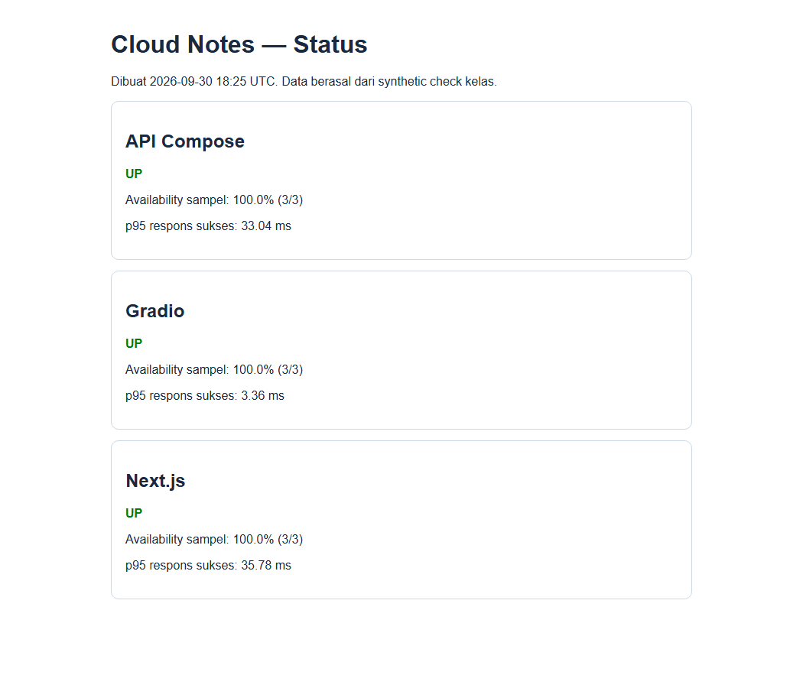
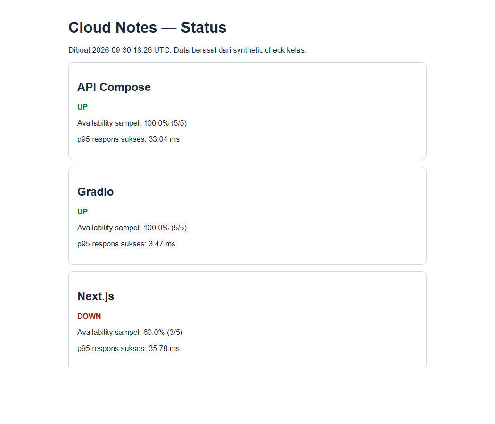
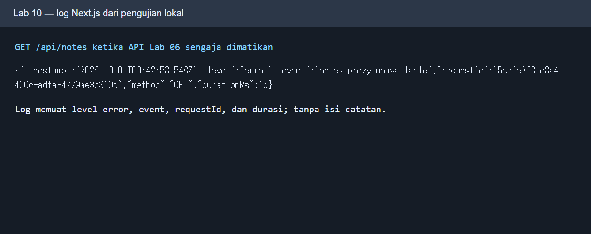

# Lab 10 — Monitoring lokal, availability, dan p95

**Kebijakan kelas:** Lab ini latihan formatif, tanpa tugas, nilai, atau penyerahan terpisah. Satu proyek besar dikerjakan oleh kelompok **3 orang**, dengan presentasi checkpoint minggu 7 (UTS) dan hasil akhir minggu 14 (UAS). Simpan hasil lab hanya bila berguna sebagai referensi atau bukti proses proyek. Baca [brief proyek kelompok](PROYEK_KELOMPOK.md). Bobot resmi tetap mengikuti RPS/LMS.

**Subtopik RPS:** observability, tiga monitor HTTP, status page, alert, dan log aplikasi. Jalur lokal menggunakan Python standard library dan layanan hasil Lab 06, 08, dan 09. Tidak perlu akun cloud atau paket Python tambahan.

Panduan ini memakai **Windows PowerShell**. Jalankan satu baris perintah setiap kali, lalu baca hasilnya sebelum lanjut. Internet diperlukan untuk clone dan pemasangan pertama. Server lokal tetap berjalan di terminalnya sampai dihentikan dengan `Ctrl+C`.

**Bukti latihan opsional:** screenshot yang tersedia menunjukkan contoh hasil pengujian sebelumnya. Angka waktu dan probabilitas pada komputer Anda dapat berbeda. Gambar terminal berlatar gelap adalah teks keluaran aktual yang ditata ulang agar terbaca, bukan screenshot terminal langsung. Simpan hasil Anda sendiri untuk referensi proyek bila berguna. Tidak ada laporan atau push terpisah yang wajib dikumpulkan.

## 1. Nyalakan tiga layanan

Jalankan modul masing-masing lebih dahulu. Semua layanan berada pada laptop yang sama:

| Layanan | Folder repo | URL yang harus terbuka |
|---|---|---|
| API Compose Lab 06 | `meet6CloudService-local` | `http://127.0.0.1:18006/health` |
| Next.js Lab 08 | `meet8CloudService-local` | `http://127.0.0.1:3000/api/health` |
| Gradio Lab 09 | `meet9CloudService-local` | `http://127.0.0.1:7860/` |

Lab 06 dijalankan dengan `docker compose up -d --build --wait` setelah `.env` siap sesuai modulnya. Biarkan terminal `npm run dev` Lab 08 dan `app.py` Lab 09 terbuka. Buka ketiga URL di browser. Halaman API harus mengembalikan JSON sehat dan Gradio harus menampilkan UI.

## 2. Clone monitor di terminal baru

Pasang Python 3.10 atau lebih baru dan Git. Buka PowerShell pada folder induk praktikum:

```powershell
git clone https://github.com/SeedFlora/meet10CloudService.git meet10CloudService-local
cd .\meet10CloudService-local
Get-Location
python --version
Get-Content .\targets.local.json
```

Folder kerja berakhir dengan `meet10CloudService-local`. Target **API Compose memakai port 18006**. Monitor tidak menjalankan ketiga aplikasi. Ia hanya memeriksa URL yang ada dalam file ini. Untuk repo yang sudah tersedia, buka folder repo tersebut dan lanjut ke langkah 3.

## 3. Ambil baseline lima pemeriksaan

```powershell
python monitor.py --count 5 --interval 3 --reset
python report.py
python status.py
Start-Process .\status.html
```

Monitor menulis `observations.jsonl`. Ada **15 baris** untuk 3 target × 5 putaran. `--reset` memulai histori baru dan cukup digunakan pada langkah ini. Report menghitung availability = check sukses / total check × 100%. p95 memakai nearest-rank dari respons sukses. Status page menampilkan hasil terakhir dan statistik kumulatif.

Hasil saat semua layanan sehat: tiga kartu **UP**, masing-masing **5/5 atau 100%** pada sampel kelas. Lima pemeriksaan tidak mewakili SLO produksi.



*Baca gambar:* nama layanan, status, dan waktu pemeriksaan. Screenshot dari run sebelumnya menunjukkan bentuk hasil. File konfigurasi terbaru pada langkah 2 menentukan URL dan port run Anda.

## 4. Simulasikan satu gangguan

Pada terminal **Next.js Lab 08**, tekan `Ctrl+C`. Biarkan API Compose dan Gradio tetap menyala. Kembali ke terminal Lab 10:

```powershell
python monitor.py --count 2 --interval 1
python report.py
python status.py
Start-Process .\status.html
```

Jalankan tanpa `--reset` supaya histori tetap ada. Next terakhir **DOWN**, dua layanan lain tetap UP. Dengan lima check sehat lalu dua gagal, availability Next menjadi **5/7 = 71,43%**. SLO contoh 99% memberi budget 0,07 kegagalan untuk tujuh check, sehingga sisa budget **-1,93 check** setelah dua gagal. Pecahan ini ilustrasi matematika kelas.



*Baca gambar:* Next DOWN sementara layanan lain tetap UP. Jumlah check pada screenshot lama dapat berbeda dari urutan lima check pada modul ini.

## 5. Pulihkan Next dan baca histori

Di terminal Lab 08, jalankan lagi `npm run dev`. Tunggu pesan Ready. Kembali ke Lab 10:

```powershell
python monitor.py --count 1 --interval 1
python report.py
python status.py
Start-Process .\status.html
```

Next kembali **UP**, tetapi availability kumulatif menjadi **6/8 = 75%** karena dua kegagalan tetap tercatat. Status HTML adalah snapshot. Jalankan `python status.py` lagi untuk memperbaruinya.

## 6. Hubungkan probe dan log aplikasi

Buat satu catatan di UI Lab 08. Pada terminal Next, baca JSON log `notes_proxy`: `requestId`, `status`, dan `durationMs`. Pada error backend, event dapat bernama `notes_proxy_unavailable`. Log per request menjelaskan kejadian tertentu. Probe berkala merangkum ketersediaan dan latensi HTTP. Keduanya belum menjadi trace terdistribusi. Jangan memasukkan isi catatan atau token ke log.



*Baca gambar:* event error, requestId, dan durasi. Contoh ini berasal dari backend yang sengaja dimatikan pada uji sebelumnya.

## 7. Periksa monitor dan selesai

```powershell
python -B tests\challenge.py
```

Hasil yang diharapkan **9 PASS, 0 FAIL**. Pemeriksa memakai server HTTP sementara, sehingga pengujian kode monitor tetap dapat dilakukan tanpa tiga aplikasi. Setelah latihan, hentikan Next/Gradio dengan `Ctrl+C` dan hentikan Compose dari folder Lab 06 dengan `docker compose down`.

Diskusikan beda status terbaru dan availability historis, pengaruh jumlah sampel pada error budget, serta informasi yang hilang ketika p95 hanya menghitung respons sukses. Simpan ringkasan dan screenshot sendiri untuk proyek bila berguna. `observations.jsonl` dan `status.html` tetap hasil lokal yang diabaikan Git. Panduan [cloud dan alert opsional](README.md) membahas monitor URL publik serta Discord. [Panduan Git](PANDUAN_GIT.md) tersedia untuk source proyek.
