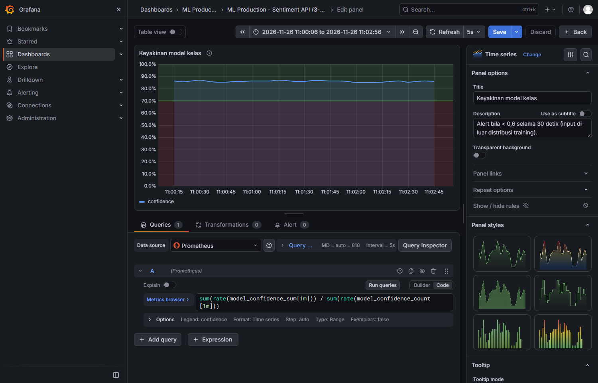
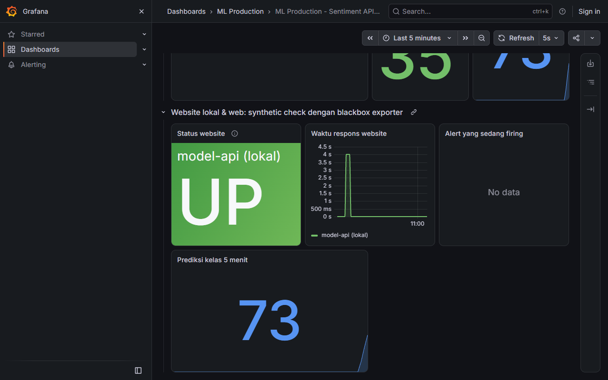
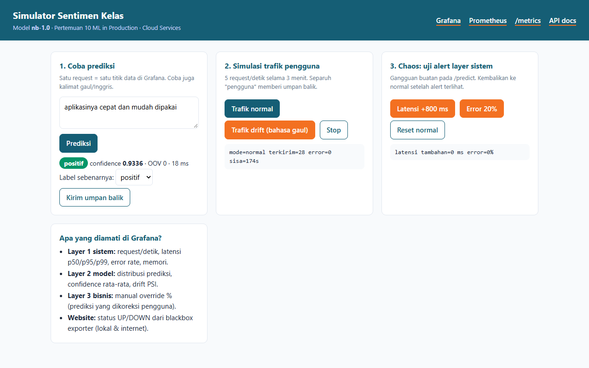

# Monitoring ML dengan Prometheus dan Grafana

Praktik untuk materi **Pertemuan 10 ML in Production, Bagian 02 Monitoring**. Satu perintah menyalakan model API sentimen yang mengekspor metrik **3 layer** (sistem, model, bisnis), Prometheus yang mengambil metrik dan mengevaluasi alert, blackbox exporter yang mengecek website lokal dan web, serta Grafana dengan dashboard yang langsung tersedia. Dosen dapat menjalankan demo di laptop dengan Docker. Mahasiswa dapat mengikuti latihan di GitHub Codespaces melalui browser. Model berjalan di CPU.

**Mulai dari mana?** Ikuti [Docker di laptop](#1-demo-dosen-di-docker-lokal) atau [Codespaces di browser](#latihan-mahasiswa-di-github-codespaces). Setelah checker menunjukkan **11/11 PASS**, coba [tombol simulator](#mengenal-simulator), [edit panel di layar](#edit-grafana-ui), [simpan desain Grafana di repo](#edit-grafana-json), atau [ubah tampilan web simulator](#edit-web-simulator). Semua path dan perintah setelah langkah `cd` dihitung dari folder `ml-monitoring`.

| Container | Image | Port laptop | Fungsi |
|---|---|---|---|
| `model-api` | build lokal dari `python:3.12-slim` | 8090 | API sentimen, `/metrics`, panel simulasi |
| `prometheus` | `prom/prometheus:v3.13.5` (LTS) | 9090 | scrape metrik tiap 5 detik, evaluasi 7 alert |
| `blackbox` | `prom/blackbox-exporter:v0.29.1` | 9115 | cek URL lokal dan internet (synthetic check) |
| `grafana` | `grafana/grafana:13.3.1` | 3001 | dashboard *ML Production - Sentiment API* |

Unduhan pertama sekitar **700 MB** (Grafana sekitar 506 MB), jadi tarik image sebelum kelas. Saat berjalan, keempat container memakai sekitar **400 MB RAM**. Grafana sengaja di port 3001 agar port 3000 tetap bebas untuk Next.js Lab 08.

> Jangan ganti Grafana ke tag `-slim`. Varian itu tidak membawa plugin data source Prometheus, sehingga semua panel gagal dengan pesan *Plugin not registered* (sudah diuji).

## 1. Demo dosen di Docker lokal

Syarat: Docker menyala (`docker version` menampilkan bagian *Server*). Perintah di bawah sama untuk PowerShell (Windows) dan Terminal (macOS/Linux):

```
git clone https://github.com/SeedFlora/meet10CloudService.git
cd meet10CloudService/ml-monitoring
docker compose up -d --build --wait
docker compose ps
```

Di Windows, `JALANKAN.bat` di folder ini juga dapat menyalakan stack dan menjalankan checker. `MATIKAN.bat` menghentikannya. Di laptop demo dosen yang sudah disiapkan, `Mulai Demo.cmd` pada folder induk **Demo Teori 10 dan Lab 08** menyalakan kedua demo sekaligus. Untuk laptop mahasiswa, gunakan perintah repo di atas.

> **⚠ SESUAIKAN DI DEVICE-MU**
> - **Windows:** Docker Desktop dengan backend WSL2. **macOS:** Docker Desktop. **Linux:** Docker Engine + plugin `docker compose` (atau Docker Desktop).
> - **Port bentrok** (pesan *port is already allocated*): ubah port host (angka di tengah) pada `docker-compose.yml`, mis. `"127.0.0.1:3002:3000"` untuk Grafana, lalu buka port baru itu.
> - **RAM untuk Docker:** sisakan minimal 2 GB karena Grafana dan Prometheus berjalan bersamaan (macOS: Docker Desktop → Settings → Resources; Windows WSL2: batas memori diatur lewat `.wslconfig`).
> - **Jaringan kampus/kantor** yang memakai proxy: unduhan image dan probe ke huggingface.co bisa gagal; coba hotspot.

Keempat container harus berstatus `Up` (model-api `healthy`). Lalu buka:

| Alamat | Isi |
|---|---|
| http://localhost:8090 | Panel simulasi: coba prediksi, kirim trafik normal/drift, chaos |
| http://localhost:9090 | Prometheus: menu *Status → Target health*, *Alerts*, *Query* |
| http://localhost:3001 | Grafana: dashboard 3 layer langsung tampil tanpa login (login `admin`/`admin` hanya untuk mengedit) |

Cek otomatis tanpa memasang apa pun di laptop:

```powershell
docker compose exec -T model-api python check_stack.py
```

Hasil yang diharapkan: **11/11 PASS**. Tambahkan `--drift` untuk ikut menguji alert drift (sekitar 1 sampai 2 menit, hasil **12/12 PASS**).

### Latihan mahasiswa di GitHub Codespaces

1. Masuk ke GitHub dan buka [repo Teori 10](https://github.com/SeedFlora/meet10CloudService). Pilih branch **main**, klik **Code → Codespaces → Create codespace on main**. Tunggu editor dan tab **Terminal** terbuka.
2. Di Terminal, jalankan baris berikut satu per satu. Tunggu sampai prompt kembali sebelum menjalankan baris berikutnya.

   ```bash
   cd ml-monitoring
   docker compose up -d --build --wait
   docker compose exec -T model-api python check_stack.py
   ```

   Hasil yang diharapkan adalah **11/11 PASS**. Pada percobaan pertama, Docker perlu mengunduh image.
3. Klik tab **Ports** di sebelah Terminal. Tambahkan port **8090** (simulator), **3001** (Grafana), dan **9090** (Prometheus) jika belum muncul. Gunakan **Forward a Port** atau **Add Port**, ketik satu nomor, lalu tekan **Enter**. Biarkan **Visibility** masing-masing **Private**.
4. Klik kanan setiap baris port dan pilih **Open in Browser**. Di tab simulator, klik **Prediksi** dan **Trafik normal**. Di Grafana, pilih **Last 5 minutes** dan refresh **5s**. Beri waktu sekitar satu menit, lalu periksa **Model API** berstatus **UP** dan grafik request serta latensi mulai terisi.
5. Di Prometheus, buka **Status → Target health** untuk melihat target. Kembali ke simulator dan klik **Trafik drift**. Di Grafana, amati perubahan confidence dan PSI. Di Prometheus, buka **Alerts** dan temukan **InputDriftPSI**. Kembalikan ke **Trafik normal** dan lihat alert pulih.
6. Setelah latihan, klik **Stop** di simulator. Di repo, buka **Code → Codespaces**, klik **…** di sebelah nama Codespace milikmu lalu **Stop codespace**.

## 2. Skenario demo (sekitar 15 menit)

Gunakan panel dan perintah pada tabel untuk mengikuti demo dari http://localhost:8090. Angka di bawah adalah hasil uji 16 November 2026.

| Langkah | Aksi | Yang terlihat di Grafana | Alert Prometheus |
|---|---|---|---|
| 1 | **Trafik normal** | sekitar 5 req/detik, p99 sekitar 2,5 ms, confidence sekitar 0,87, PSI sekitar 0,01, override di bawah 1% | tidak ada |
| 2 | **Trafik drift** (bahasa gaul dan campur Inggris) | p99 tetap di bawah 5 ms dan error 0%, tetapi confidence turun ke sekitar 0,43, PSI melonjak ke sekitar 8,8, override sekitar 54% | `InputDriftPSI`, `ConfidenceTurun`, `ManualOverrideTinggi` (firing sekitar 70 detik setelah klik) |
| 3a | **Trafik normal**, lalu **Latensi +800 ms** | p99 naik dan laju permintaan dapat turun | `LatensiP99Tinggi` bila kondisi bertahan |
| 3b | Klik **Error 20%** untuk beralih ke gangguan berikutnya | sebagian permintaan mendapat HTTP 500. Persentase sesaat bervariasi | `ErrorRateTinggi` bila kondisi bertahan |
| 4 | `docker compose stop model-api` | Model API dan website model-api `DOWN` | `ModelApiDown`, `WebsiteDown` |
| 5 | `docker compose start model-api`, **Reset normal**, **Trafik normal** | semua panel pulih | alert kembali *inactive* |

Pada langkah 2, respons API bisa tetap cepat ketika model semakin ragu. Gunakan sampel dengan label pembanding atau umpan balik untuk menilai apakah prediksinya keliru.

<a id="mengenal-simulator"></a>
### Apa yang dilakukan setiap tombol?

1. Buka **8090**. Pada **Coba prediksi**, ketik `materi cloud membingungkan` lalu klik **Prediksi**. Baca label, confidence, OOV, dan waktu respons untuk satu kalimat. OOV adalah proporsi kata di luar kosakata model. Pada **Label sebenarnya**, pilih penilaianmu sendiri, lalu klik **Kirim umpan balik**. Server membandingkan dua label tersebut.
2. Klik **Trafik normal**. Pengirim otomatis memilih contoh acak dengan kosakata yang familier. Contoh di repo mencakup `pengiriman ke bandung cepat dan rapi` (positif), `materi cloud membingungkan` (negatif), dan `jadwal praktikum diumumkan besok` (netral). Normal menerangkan kemiripan masukan dengan data rujukan. Di layar, `mode=normal`, `terkirim` bertambah, dan `sisa` menghitung waktu. Target tombol adalah 5 permintaan/detik selama 180 detik. Sekitar separuh permintaan yang berhasil mengirim umpan balik tiruan.
3. Buka **3001**, pilih **Last 5 minutes** dan refresh **5s**. Setelah sekitar satu menit, catat p99, confidence rata-rata, dan PSI. Klik **Trafik drift (bahasa gaul)** di 8090. Contoh baru berasal dari kelompok lain seperti `gokil sih ini, worth it banget` dan `ngebug mulu, uninstall aja deh`. Modelnya tetap; kosakata yang masuk berubah. Bandingkan sisi kanan grafik pada rentang waktu yang sama. PSI mengukur pergeseran distribusi OOV. Confidence dan PSI membantu memilih sampel untuk ditinjau bersama labelnya.
4. Di **9090 → Alerts**, cari `InputDriftPSI`. Saat PSI melebihi 0,2, aturan bisa **Pending**, lalu **Firing** setelah kondisi bertahan 30 detik. Klik **Trafik normal** kembali dan tunggu sampel baru menggantikan sampel drift. Alert kembali **Inactive** saat kondisinya pulih. Puncak lama masih terlihat selama rentang grafik memuat waktu kejadian.
5. Untuk menguji gangguan sistem, hidupkan trafik lalu pilih **Latensi +800 ms** atau **Error 20%**. Pilihan pertama menambah waktu tunggu pada endpoint prediksi, pilihan kedua berpeluang mengirim HTTP 500. Setiap tombol mengganti kedua parameter gangguan sekaligus. **Reset normal** menghapus gangguan. **Stop** menghentikan kiriman otomatis. Jadi untuk pulih dari latihan chaos sambil mengisi grafik, klik **Reset normal**, lalu **Trafik normal**.

## 3. Pantau website hasil deploy (lokal dan web)

Blackbox exporter mengecek URL dari dalam Docker, seperti pengguna yang membuka website. Daftar URL ada di `prometheus/targets/web.yml` dan dibaca ulang otomatis tiap 30 detik, jadi tidak perlu restart.

```yaml
- targets: ["https://<user>-<space>.hf.space"]          # Hugging Face Space
  labels: {app: sentimen-space, lokasi: web}
- targets: ["https://<project>.vercel.app/api/ready"]   # Next.js Lab 08 di Vercel
  labels: {app: cloud-notes, lokasi: web}
```

Di *Status → Target health → web-probe*, status UP menunjukkan bahwa Prometheus berhasil membaca jawaban exporter. Di **Query**, jalankan `probe_success{job="web-probe"}` untuk membaca hasil uji URL; nilai 1 berarti probe berhasil dan 0 berarti gagal. Nilai inilah yang dipakai panel **Status website**. Aplikasi lab yang jalan di laptop dapat dijangkau lewat `host.docker.internal` bila alamat dan konfigurasi server mengizinkan akses dari container (contoh ada di file target). Jika Space sedang tidur atau mulai menyala, probe dapat gagal sementara. Periksa status hosting sebelum menyimpulkan penyebabnya.

## 4. PromQL yang dipakai dashboard

| Layer | Pertanyaan | PromQL |
|---|---|---|
| Sistem | Request per detik | `sum(rate(http_requests_total{path="/predict"}[1m]))` |
| Sistem | p99 latensi | `histogram_quantile(0.99, sum by (le) (rate(http_request_duration_seconds_bucket{path="/predict"}[1m])))` |
| Sistem | Error rate | `sum(rate(http_requests_total{path="/predict",status=~"5.."}[1m])) / sum(rate(http_requests_total{path="/predict"}[1m]))` |
| Model | Distribusi prediksi | `sum by (label) (rate(model_predictions_total[1m]))` |
| Model | Confidence rata-rata | `sum(rate(model_confidence_sum[1m])) / sum(rate(model_confidence_count[1m]))` |
| Model | Drift | `model_input_drift_psi` |
| Bisnis | Manual override | `sum(rate(model_feedback_total{verdict="salah"}[2m])) / sum(rate(model_feedback_total[2m]))` |
| Website | Status URL | `probe_success{job="web-probe"}` |

Drift dihitung dengan **PSI** (Population Stability Index) pada rasio kata yang tidak dikenal model (OOV) di 100 request terakhir, dibandingkan dengan data referensi. Patokan umum: di bawah 0,1 stabil, 0,1 sampai 0,2 waspada, di atas 0,2 drift. Kode ada di `model-api/model.py` (`psi`, `oov_bins`) dan `model-api/app.py`.

## Modifikasi tampilan

Pilih bagian yang ingin dicoba. Mulai dari [editor panel Grafana](#edit-grafana-ui) untuk melihat pratinjau, lanjutkan ke [file desain dashboard](#edit-grafana-json) untuk menyimpan hasil di repo, atau langsung [ubah judul dan warna simulator](#edit-web-simulator).

| Bagian yang ingin diubah | File yang dibuka di editor | Cara menerapkan |
|---|---|---|
| Judul, warna, unit, posisi atau kueri panel Grafana | [grafana/dashboards/ml-production.json](grafana/dashboards/ml-production.json) | Simpan file, restart **grafana**, lalu buka dashboard pada port **3001**. |
| Header, warna tombol, teks awal, durasi dan laju kiriman simulator | [model-api/static/index.html](model-api/static/index.html) | Simpan, bangun ulang **model-api**, lalu muat ulang halaman port **8090**. |
| Contoh ulasan otomatis dan label acuannya | [model-api/model.py](model-api/model.py) | Edit kumpulan contoh yang dituju, bangun ulang **model-api** dan mulai trafik lagi. |
| Ambang dan durasi sebelum alert menyala | [prometheus/alerts.yml](prometheus/alerts.yml) | Validasi dengan **promtool**, restart **prometheus**, lalu periksa **Alerts** pada port **9090**. |
| Website yang statusnya dipantau | [prometheus/targets/web.yml](prometheus/targets/web.yml) | Simpan target, tunggu pembacaan ulang, lalu periksa hasil probe seperti di bagian 3. |

<a id="edit-grafana-ui"></a>
### 4A. Coba mengubah panel Grafana di layar

1. **Buka dashboard kelas.** Di laptop, buka [dashboard ML Production](http://127.0.0.1:3001/d/ml-production?from=now-5m&to=now&refresh=5s). Di Codespaces, pilih **Ports → 3001 → Open in Browser**. Bila yang terbuka halaman awal, pilih **Dashboards → ML Production** lalu dashboard **ML Production … Sentiment API**. Port yang dibuka dari Codespaces mempunyai alamat HTTPS sendiri. Jalur **Ports** juga berlaku untuk 8090 dan 9090.
2. **Temukan panel.** Di simulator 8090 klik **Trafik normal**. Biarkan tab terbuka. Di Grafana pilih rentang lima menit dan refresh lima detik. Gulir ke **Layer 2 – Model** dan cari panel **Confidence rata-rata**. Metriknya menghitung rata-rata confidence di jendela satu menit. Pada skala mentah 0–1, nilai 0,85 ditampilkan sebagai 85%.
3. **Pilih akses untuk latihan.** Dashboard kelas terbuka sebagai **Viewer** untuk pengunjung anonim. Untuk mencoba editor pada instance kelas privat milikmu, buka menu akun dan pilih **Sign in**, atau buka `/login` pada alamat Grafana yang sama. Konfigurasi awal lab adalah `admin` / `admin`. Jika Grafana meminta mengganti sandi, ikuti petunjuk di instance milikmu. Jika sandi sudah diganti, gunakan sandi pemilik instance. Kamu juga bisa langsung mengikuti jalur file di bagian 4B dengan akses Viewer.
4. **Buka editor panel.** Setelah login, arahkan kursor ke judul **Confidence rata-rata** di Layer 2, klik menu panel **⋮ → Edit**. Jika perlu, klik **Edit** pada toolbar dashboard untuk masuk ke mode edit terlebih dahulu. Di sisi kanan editor panel, cari **Panel options → Title**, lalu ketik **Keyakinan model kelas**.
5. **Atur angka dan penanda visual.** Di **Standard options**, pilih unit **Percent (0.0–1.0)** dan **Decimals = 1**. Pilih warna tunggal biru pada **Color scheme**. Di **Thresholds**, pertahankan mode **Absolute**, warna dasar merah, lalu ubah batas hijau dari **0.6** menjadi **0.7**. Panel menampilkan batas visual 70%. Tombol **Run queries** di editor menyegarkan pratinjau. Angka berubah sesuai trafik.
6. **Simpan dan pahami tempat penyimpanannya.** Pada Grafana versi kelas, gunakan **Save** di kanan atas editor. Jika dialog konfirmasi muncul, isi keterangan singkat dan konfirmasi. Tekan **Back** untuk melihat dashboard. Penyimpanan dari UI masuk ke database Grafana di volume Docker. Sumber yang dipakai saat deploy adalah file JSON di repo. Ketika isi file sumber berubah dan dimuat ulang, Grafana akan memakai isi file tersebut. Untuk membawa desain ke Codespace lain, gunakan langkah 4B. [Dokumentasi provisioning Grafana](https://grafana.com/docs/grafana/latest/administration/provisioning/#make-changes-to-a-provisioned-dashboard)



<a id="edit-grafana-json"></a>
### 4B. Simpan desain Grafana di repo dan tambahkan panel

**Buka file yang benar.** Di Codespaces gunakan ikon **Explorer** di kiri editor. Di Windows buka folder clone di editor kode. Pilih **ml-monitoring → grafana → dashboards → ml-production.json**. Dari terminal yang sudah di `ml-monitoring`, jalurnya `grafana/dashboards/ml-production.json`. Sebelum mencoba, boleh salin file asli ke folder pribadi **di luar** `grafana/dashboards`. Grafana membaca file JSON di folder dashboard tersebut.

**Latihan 1 – ubah panel yang sudah ada**

1. Tekan **Ctrl+F** dan cari teks persis `"title": "Confidence rata-rata"`. Objek yang sama memiliki `"id": 12`. Ganti judul panel itu menjadi `Keyakinan model kelas`. Bagian paling atas file berisi identitas dashboard. Pertahankan nama file, UID dashboard `ml-production` dan UID data source `prometheus` yang dirujuk target serta checker.
2. Masih pada **objek panel 12**, cari `fieldConfig` lalu `defaults`. Gunakan tabel sebagai nilai akhir. Jika sebuah properti sudah ada, edit nilainya di tempat. Tambahkan `"decimals": 1,` sesudah properti `unit` bila belum ada. Simpan dengan **Ctrl+S**.

   | Lokasi di panel 12 | Nilai akhir | Yang terlihat |
   |---|---|---|
   | `title` | `"Keyakinan model kelas"` | Judul grafik berubah |
   | `fieldConfig.defaults.unit` | `"percentunit"` | 0,854 ditampilkan sebagai persentase |
   | `fieldConfig.defaults.decimals` | `1` | Contoh tampilan 85,4% |
   | `fieldConfig.defaults.color` | `{"mode":"fixed","fixedColor":"blue"}` | Garis metrik berwarna biru |
   | `fieldConfig.defaults.thresholds.steps` | `[{"color":"red","value":null},{"color":"green","value":0.7}]` | Area hijau mulai pada 70% |

   Biarkan `custom.thresholdsStyle.mode` bernilai `line+area`. Penanda warna pada grafik ini hanya mengubah cara membacanya. Aturan alert operasional `ConfidenceTurun` memiliki ekspresi sendiri di `prometheus/alerts.yml`.

**Latihan 2 – duplikasi panel statistik untuk menghitung prediksi lima menit terakhir**

1. Uji kuerinya dulu. Di **9090 → Query**, masukkan `sum(increase(model_predictions_total[5m])) or vector(0)` lalu **Execute**. Hasilnya satu angka. `increase` memperkirakan pertambahan penghitung dalam lima menit dan `sum` menjumlahkan semua label. Saat belum ada sampel, `vector(0)` memberi nilai awal nol. Setelah trafik normal berjalan dan ada beberapa sampel, angkanya naik.
2. Kembali ke file JSON. Cari `"title": "Prediksi 15 menit"`, panel `id` **17**. Pilih seluruh objek panel dari `{` sebelum `"type": "stat"` sampai `}` sesudah `options`. Editor menyorot pasangan kurung saat kursor berada di sebelah kurungnya. Salin objek lengkap agar opsi dan sumber data ikut terbawa.
3. Cari akhir array `"panels": [ ... ]`. Di antara penutup `}` objek terakhir dan penutup `]` array, sisipkan koma setelah objek terakhir, lalu tempel objek salinan sebagai anggota baru. Simpan semua panel lama. Objek salinan kini perlu identitas, posisi, dan kueri sendiri.
4. Edit **hanya salinan baru** menggunakan nilai berikut. Pada versi kelas, ID tertinggi 21, dan baris panel terakhir berakhir di koordinat 38. Jika sudah menambahkan panel lain, pilih ID yang belum dipakai dan posisi di bawah panel terakhirmu.

   | Properti pada salinan | Nilai |
   |---|---|
   | `id` | `22` |
   | `title` | `"Prediksi kelas 5 menit"` |
   | `gridPos` | `{"h":7,"w":12,"x":0,"y":38}` |
   | `targets[0].expr` | `"sum(increase(model_predictions_total[5m])) or vector(0)"` |
   | `targets[0].legendFormat` | `"prediksi"` |

5. Biarkan kedua rujukan data source pada salinan memakai UID `prometheus`. Simpan file. Di editor Windows dan Codespaces, garis merah pada koma atau kurung menandakan sintaks JSON perlu diperiksa. JSON memakai tanda kutip ganda dan tidak menerima koma setelah anggota terakhir.

**Muat dan periksa kedua latihan**

1. Simpan JSON di editor. Folder dashboard dan provisioning dipasang ke container sebagai *bind mount* baca-saja. **Di Docker Desktop Windows, restart layanan Grafana** agar perubahan file langsung dimuat. Pada uji kelas, menyegarkan browser saja masih menampilkan panel lama. Di Codespaces kamu juga bisa memakai langkah ini. Jalankan dari `ml-monitoring`, satu baris setiap kali. Langkah ini mempertahankan data Prometheus dan tidak membangun ulang image.

   ```sh
   docker compose restart grafana
   docker compose logs --tail 40 grafana
   docker compose exec -T model-api python check_stack.py
   ```

2. Di **3001**, periksa judul baru pada Layer 2 serta panel **Prediksi kelas 5 menit** di bagian bawah. Klik **Trafik normal** di 8090 dan tunggu sampel mengisi panel baru. Checker harus tetap **11/11 PASS**. Untuk memastikan server sudah memuat nama dan ID yang tepat, jalankan perintah ini dari terminal Docker lokal atau Codespaces.

   ```sh
   docker compose exec -T model-api python -c "import json, urllib.request as u; d=json.load(u.urlopen('http://grafana:3000/api/dashboards/uid/ml-production'))['dashboard']; print([(p['id'],p['title']) for p in d['panels'] if p['id'] in (12,22)])"
   ```

   Cari `(12, 'Keyakinan model kelas')` dan `(22, 'Prediksi kelas 5 menit')`. Alamat internal `grafana:3000` berlaku dari container; tab browser memakai port **3001**. File `grafana/provisioning/datasources/prometheus.yml` menghubungkan Grafana ke `http://prometheus:9090` di jaringan Docker.



<a id="edit-web-simulator"></a>
### 4C. Ubah tampilan dan contoh masukan di simulator

1. Buka **model-api → static → index.html**. Cari `<h1>Sentiment API · Panel Simulasi Monitoring</h1>`. Ganti isi judul, misalnya menjadi `<h1>Simulator Sentimen Kelas</h1>`. Di bagian CSS `:root`, ganti token `--navy:#002677;` menjadi `--navy:#155E75;`. Simpan. Judul pada header dan warna yang memakai variabel itu akan berubah. Tombol tetap bekerja selama atribut `id` dan pemanggilan fungsi seperti `onclick="predict()"` dipertahankan.
2. Untuk mengganti contoh yang langsung tampil di kotak teks, edit teks di antara tag `<textarea id="text">` dan `</textarea>`. Untuk mengganti **contoh yang dikirim otomatis**, buka `model-api/model.py`. `NORMAL_POOL = TRAIN + HELDOUT`; `DRIFT_POOL` adalah daftar untuk tombol drift. Coba tambahkan satu pasangan teks dan label ke `DRIFT_POOL`, misalnya `("sat set, kelasnya worth it", "positif"),`. Pilih `positif`, `negatif`, atau `netral`. Kiriman dipilih acak. Untuk memeriksa kalimat baru segera, ketik manual di **Coba prediksi**. Mengubah `TRAIN` ikut mengubah model yang dilatih saat startup.
3. Jika ingin menyesuaikan durasi atau laju, cari `async function sim(mode)` di HTML. Tombol saat ini mengirim `duration_s: 180, rps: 5` ke `/simulate`. Misalnya pakai `duration_s: 120, rps: 3` dan sesuaikan tulisan petunjuk di atas tombol. API menerima durasi 10–1800 detik dan laju lebih dari nol hingga 20 permintaan/detik.
4. Dockerfile menyalin HTML dan kode model ke **image** saat build. Dari `ml-monitoring`, bangun ulang **model-api** dan tunggu siap. Perintah ini berlaku di PowerShell Windows maupun terminal Codespaces.

   ```sh
   docker compose up -d --build --wait model-api
   docker compose exec -T model-api python check_stack.py
   ```

5. Buka kembali 8090 melalui jalur yang sama. Muat ulang dengan **Ctrl+Shift+R**. Periksa judul **Simulator Sentimen Kelas**, header hijau kebiruan, dan hasil **Prediksi** untuk sebuah kalimat. Checker kembali **11/11 PASS**. Memulai ulang model menghentikan pengirim trafik dalam proses tersebut dan memulai ulang penghitung di memori. Klik **Trafik normal** kembali agar grafik menerima sampel baru.



### 4D. Bedakan warna pada grafik dan peringatan yang benar-benar menyala

Misalkan kelas ingin warna hijau mulai 70%, tetapi tim baru perlu menyelidiki bila confidence turun di bawah 60% secara berkelanjutan. Itu sudah bisa dicapai dengan panel 12 di atas dan aturan bawaan. Untuk latihan opsional berikut, ubah **aturan Prometheus** pada salinan proyek sendiri.

1. Dari `ml-monitoring`, buka [prometheus/alerts.yml](prometheus/alerts.yml). Cari `alert: ConfidenceTurun`. Di blok itu saja, ubah angka pada akhir `expr` dari `< 0.6` menjadi `< 0.7` dan `for: 30s` menjadi `for: 45s`. Sesuaikan teks `annotations.summary` agar menyebut **0,7**. Biarkan indentasi YAML seperti semula.
2. Periksa sintaks **sebelum** menerapkan konfigurasi. Dari terminal kelas, jalankan perintah pertama berikut. Setelah terlihat `SUCCESS`, jalankan perintah kedua. Jika muncul galat, baca nomor baris, perbaiki YAML, dan ulangi pemeriksaan.

   ```sh
   docker compose exec -T prometheus promtool check rules /etc/prometheus/alerts.yml
   docker compose restart prometheus
   ```

3. Buka **9090 → Alerts → ConfidenceTurun**. Periksa ekspresi dan waktu tunggu yang baru. Klik **Trafik normal** pada simulator untuk mengisi sampel, lalu **Trafik drift**. Saat rata-rata confidence satu menit turun di bawah 0,7, aturan bisa masuk **Pending**. Jika syarat terus terpenuhi selama 45 detik, evaluasi berikutnya dapat menampilkan **Firing**. Pergantian tombol dan waktu munculnya alert dapat berbeda karena ada jendela metrik dan interval evaluasi.
4. Setelah mencoba, pilih **Trafik normal**, tunggu pemulihan, lalu **Stop**. Untuk mengikuti slide kelas berikutnya dengan konfigurasi bawaan, kembalikan angka `0.6`, durasi `30s`, serta teks ringkasannya. Ulangi validasi dan restart Prometheus.

### Simpan hasil di GitHub milikmu (opsional)

Jika ingin menyimpan hasil online, mulai dari **Fork** repo kelas ke akunmu, lalu clone atau buat Codespace **dari fork tersebut**. Edit file sumber seperti pada latihan di atas. Dari folder `ml-monitoring`, gunakan `git status` dan `git diff` untuk meninjau perubahan. Di editor Codespaces buka **Source Control**, klik **+** pada file yang ingin disimpan, isi pesan singkat, lalu **Commit** dan **Sync Changes** atau **Publish Branch** ke fork milikmu. Buka README atau file yang diubah pada branch yang sama di GitHub. Jika hanya bereksperimen di laptop, cukup simpan file di folder proyek.

### Kembali ke tampilan sebelumnya tanpa membuang pekerjaan lain

Untuk satu nilai yang baru diubah, gunakan **Undo** di editor atau isikan nilai lama dari tabel dan contoh di atas. Jika perlu kembali ke salinan pribadi, bandingkan kedua file dan pulihkan hanya bagian percobaan. Dengan Git, dari `ml-monitoring`, tinjau perubahan lebih dahulu.

```sh
git diff -- grafana/dashboards/ml-production.json model-api/static/index.html model-api/model.py
```

Untuk membatalkan potongan tertentu yang belum di-stage, gunakan `git restore -p -- model-api/static/index.html` atau ganti dengan path file yang dipilih. Periksa tiap potongan sebelum menjawab. `y` membatalkan potongan yang sedang tampil, `n` mempertahankannya, dan `q` berhenti. Jika satu potongan mencampur pekerjaan lain, pilih `n` dan edit manual. Setelah memulihkan JSON, jalankan `docker compose restart grafana`. Setelah memulihkan HTML atau bagian model, jalankan `docker compose up -d --build --wait model-api`. Tutup latihan dengan pemeriksaan kembali, lalu pilih **Stop** pada simulator.

## 5. Struktur folder

```
ml-monitoring/
├─ docker-compose.yml
├─ model-api/            app.py (metrik + simulator), model.py (Naive Bayes + PSI), check_stack.py
├─ prometheus/           prometheus.yml, alerts.yml (7 alert), targets/web.yml
├─ blackbox/             blackbox.yml
└─ grafana/              provisioning (data source + dashboard), dashboards/ml-production.json
```

## 6. Masalah umum

| Gejala | Penyebab dan solusi |
|---|---|
| `port is already allocated` | Port 8090, 9090, 9115, atau 3001 dipakai aplikasi lain. Ubah port host di `ports`, misalnya `"127.0.0.1:3002:3000"`. |
| Panel Grafana *No data* | Klik **Trafik normal**, pastikan penghitung terkirim naik, pilih **Last 5 minutes** dan tunggu sekitar satu menit. Di 9090 jalankan `up{job="model-api"}`; nilai 1 berarti target berhasil diambil. Lalu uji ekspresi panel di tab **Query**. |
| Grafana bisa dilihat, tombol **Edit** tidak tersedia | Akses anonim membuka peran Viewer. Login ke instance latihan pribadi untuk langkah 4A atau edit file dengan langkah 4B. |
| Edit UI menghilang setelah sumber repo diperbarui | Provisioning memuat desain dari `grafana/dashboards/ml-production.json`. Masukkan desain yang ingin dibawa ke komputer lain ke file tersebut. |
| Setelah restart, panel baru tidak muncul | Periksa koma dan kurung JSON. Di PowerShell gunakan `Get-Content -Raw grafana/dashboards/ml-production.json \| ConvertFrom-Json \| Out-Null`. Di Codespaces gunakan `python3 -m json.tool grafana/dashboards/ml-production.json > /dev/null`. Sukses tanpa pesan berarti sintaks valid. Cocokkan ID yang unik dan posisi panel, baca `docker compose logs --tail 40 grafana`, lalu cek judul lewat perintah pada 4B. |
| Di Codespaces tautan Grafana dari simulator membuka alamat yang salah | Kembali ke tab **Ports**, lalu **Open in Browser** pada **3001**. Pakai **9090** untuk Prometheus. Alamat port HTTPS milik setiap Codespace berbeda. |
| HTML di editor sudah berubah tetapi 8090 masih versi lama | Pastikan file yang diedit `model-api/static/index.html`, jalankan kembali build khusus model-api pada 4C, lalu muat ulang paksa tab 8090. |
| Website web `DOWN` | Cek internet atau proxy kampus. HF Space yang tidur perlu dibuka sekali di browser. |
| `docker compose` tidak dikenal | Perbarui Docker Desktop (Compose v2 sudah termasuk). |
| Ingin menghentikan lalu melanjutkan kelas | `docker compose down` mempertahankan volume. Gunakan `docker compose up -d --build --wait` untuk mulai lagi. Opsi `-v` pada saat down menghapus riwayat metrik dan penyimpanan Grafana pada volume. |

Matikan setelah selesai dengan `docker compose down` (data metrik tetap tersimpan di volume).

## 7. Catatan untuk produksi

- `scrape_interval` 5 detik dan `for: 15s/30s` sengaja pendek untuk demo. Di produksi umumnya 15 sampai 30 detik dan 5 sampai 10 menit agar alert tidak berisik.
- Port stack hanya terbuka pada `127.0.0.1`. Login anonim dan password `admin` dipakai untuk lab lokal.
- Model API berjalan dengan satu worker. Bila memakai banyak worker, gunakan mode multiprocess `prometheus_client`.
- Alert di sini hanya tampil di Prometheus dan Grafana. Untuk notifikasi (email, Discord, Slack), tambahkan Alertmanager.

## 8. Bukti uji

Versi awal diuji pada 16 November 2026 di Linux dengan Docker 29.9.3 dan Compose v5.
Cek stack dengan `--drift` menghasilkan 12/12 PASS. Proxy jaringan workspace
dipakai untuk probe internet. Saat mengulang di lab, simpan keluaran
`docker compose ps` dan `check_stack.py --drift`, lalu bandingkan kondisi normal,
drift, dan pemulihan.

Pada 26 November 2026, contoh modifikasi di atas juga diuji pada salinan terpisah di Docker Desktop Windows. Setelah file disimpan dan layanan terkait dimuat ulang, Grafana menampilkan **18 panel data** termasuk **Prediksi kelas 5 menit**, simulator menampilkan judul baru dan tetap menghasilkan prediksi, dan checker mencatat **11/11 PASS**. Contoh perubahan `ConfidenceTurun` lolos validasi tujuh aturan. Prometheus memuat ambang 0,7 selama 45 detik dan kembali ke 0,6 selama 30 detik setelah dipulihkan. URL Space atau Vercel milik tiap kelompok perlu diperiksa dengan konfigurasi target kelompoknya sendiri.
